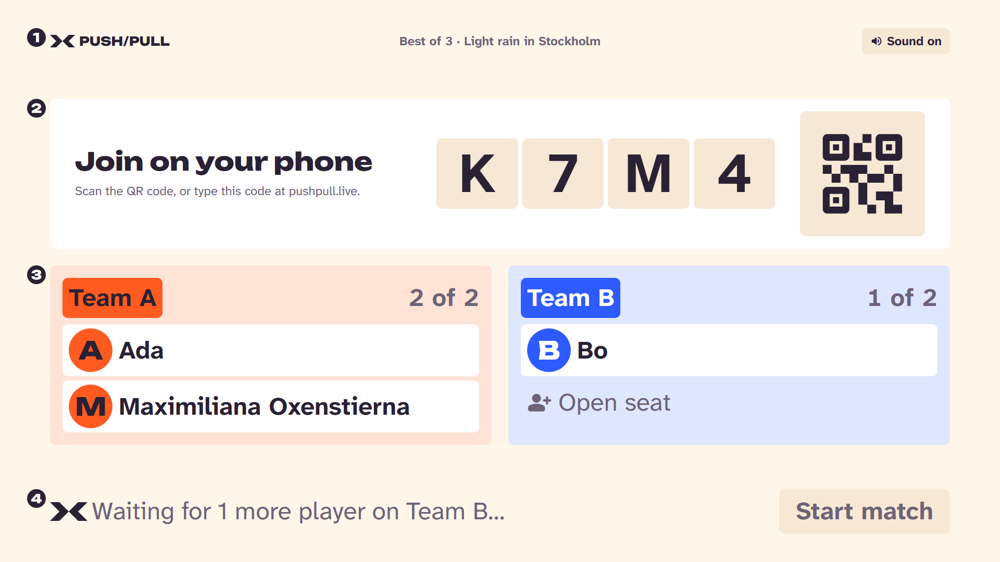
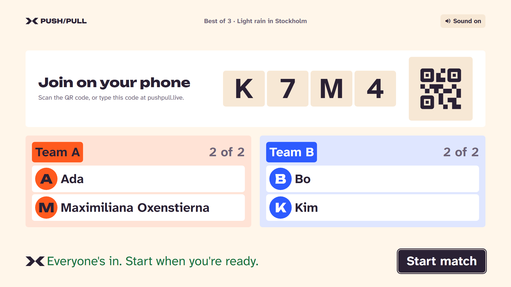
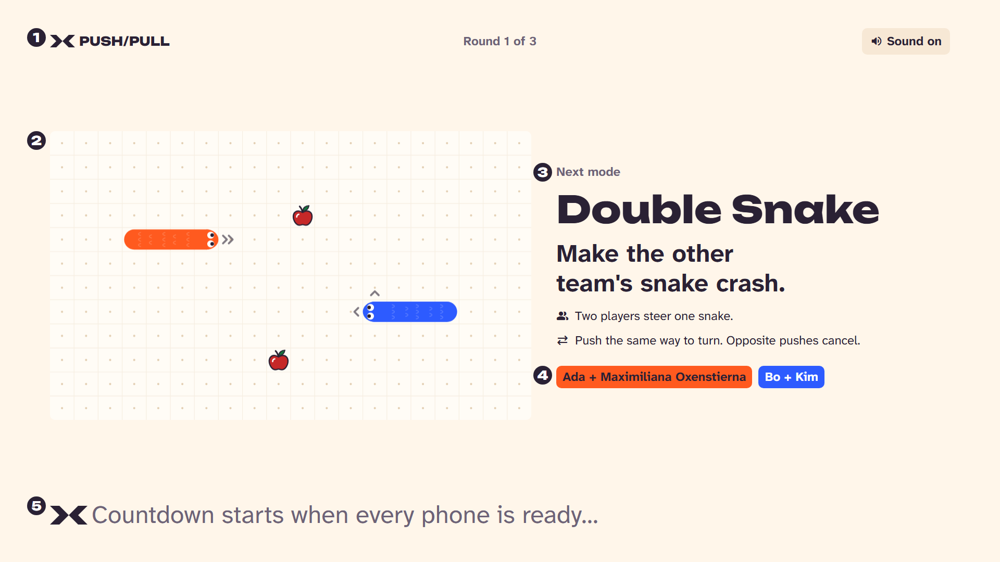
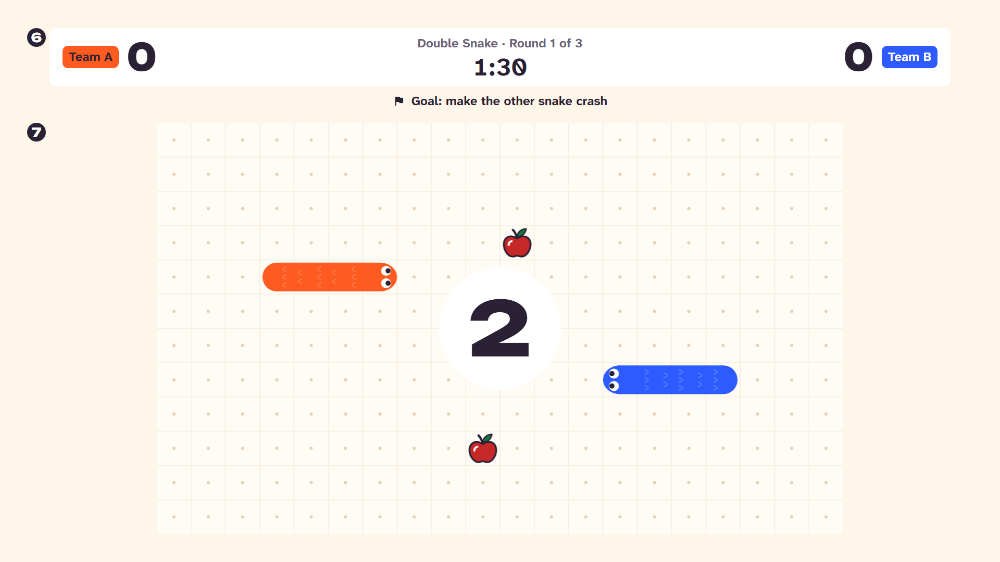
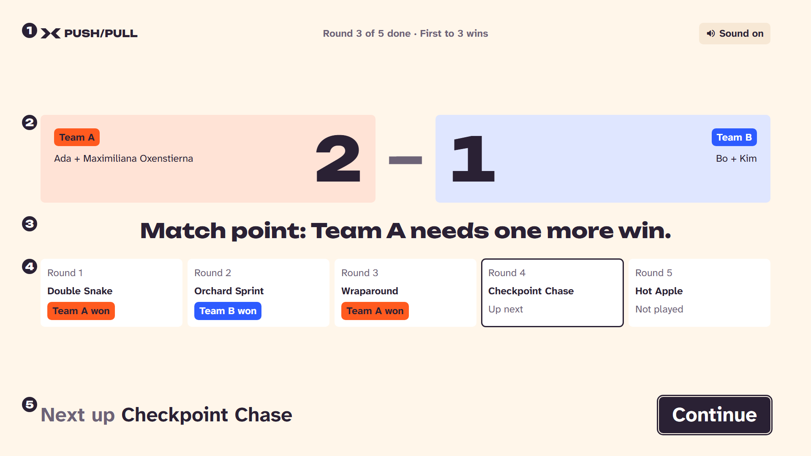
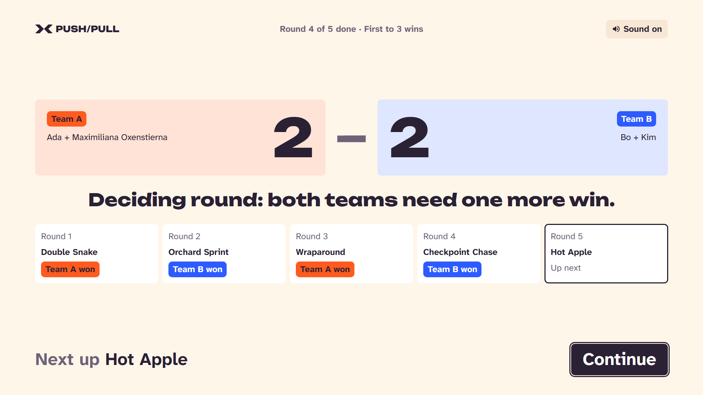
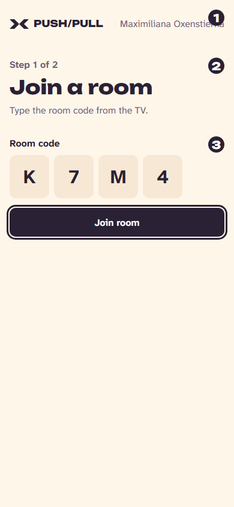
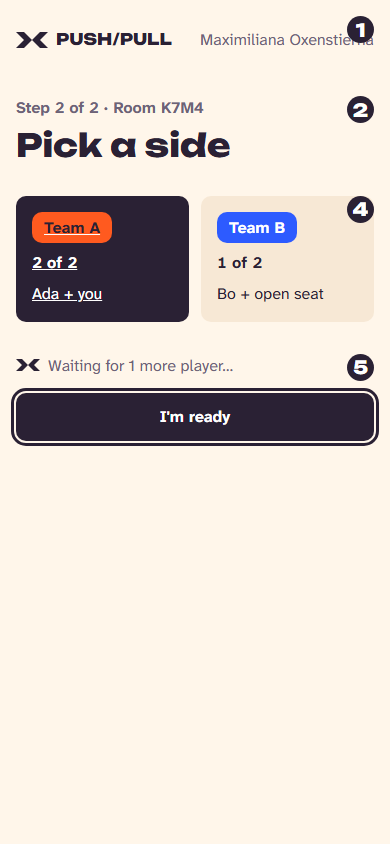

# Visual direction for the full-screen revamp

**Status: proposed in #133, waiting for team sign-off.** Part of the polish plan in #118.

Four reference screens show how Push/Pull should look on the TV, a laptop and a phone before anyone rebuilds a screen: the **TV lobby**, the **TV mode intro**, the **TV scoreboard between modes** and the **phone join**. They are built from the real shared components and tokens, so a View that copies them will look the same.

This builds on [design.md](../design.md) and changes none of its rules or tokens. design.md says *what* the parts look like. This page says how a whole screen is put together.

## Open the references

1. Run `npm run dev`.
2. Open <http://localhost:8080/docs/visual-direction/>. The comparison sheet shows every reference at quarter-size TV (the sofa test) and at real phone size, side by side.
3. Click a name to open one reference on its own, with the numbers used on this page. Each one also works without numbers, for example `#/lobby/ready`.

The page is a design reference, not part of the app: `vite build` doesn't include it. The code is in [references.jsx](references.jsx) and [references.css](references.css). Every rule in the CSS uses tokens, so a View can copy any of it.

| Reference | States | Address |
|---|---|---|
| TV lobby | 3 of 4 players, everyone in | `#/lobby/waiting`, `#/lobby/ready` |
| TV mode intro | rules card, countdown | `#/intro/rules`, `#/intro/countdown` |
| TV scoreboard between modes | match point, deciding round | `#/scoreboard/match-point`, `#/scoreboard/deciding` |
| Phone join | room code, pick a side | `#/join/code`, `#/join/team` |

## The direction in eight rules

1. **The same frame on every TV screen.** A quiet **rail** on top (logo, where we are in the match, sound), one **stage** in the middle, and a **next step** row at the bottom (status in words on the left, the one primary button on the right). The game itself is the exception: there the score bar is the rail and the board is the stage.
2. **One loudest thing per screen,** clearly bigger than everything else: the room code in the lobby, the mode name on the intro, the series score on the scoreboard, the board during play, and the room code boxes on the phone.
3. **Team A is always on the left and Team B on the right,** on every TV screen: rosters, scores, the score bar. On the phone, Team A comes first.
4. **Read it from the sofa.** Anything a player *must* read from 2–3 m (their own name, the status next to the primary action, the score, what's next) is `--tv-title` or bigger. `--tv-text` is only for supporting details. Check by shrinking the 1080p screenshot to a quarter, as on the comparison sheet.
5. **The next step always sits in the same place:** bottom right on the TV, at the end of the column on the phone. When it can't be pressed yet, the status line next to it says why ("Waiting for 1 more player on Team B…").
6. **States are words, not only colour or motion.** "Match point: Team A needs one more win", "Team B won", "Up next". Team colours always come with the team name.
7. **Flat Toy box surfaces, as design.md says.** The page is `--color-bg`, a stage card is `--color-surface`, team areas use the team's soft colour, and inputs and codes use `--color-sunken`. Never a card inside a card.
8. **Remove before you add.** Three to five things per TV screen. The lobby lost its separate settings line: best-of and weather moved into the rail.

## Type, spacing and artwork scale

**TV type.** Each screen uses at most three of these sizes:

| Level | Size | Font | Used for |
|---|---|---|---|
| Supporting | `--tv-text` | Text | Rail, rules list, round strip, sentences under a heading |
| Must-read | `--tv-title` | Text bold, or display for headings | Headings, lobby rosters, the next-step row, the mode goal, the match-point line |
| Big number or name | `--tv-score` | Display 800 | Mode name, score bar scores |
| Hero | `calc(var(--tv-score) * 2)` | Display 800 | The series score (only one per screen). Countdown already uses this size. |
| Room code | `calc(var(--tv-score) * 1.5)` | Numbers | The lobby room code |

**Phone type:** `--text-body` for sentences, `--text-hero` in the display font for the screen title, and the room code input's own size. A small bold muted line above the title says the step ("Step 1 of 2").

**Spacing** follows the ladder in the ui-design skill. On the TV the frame's rows are `--space-6` apart, panels have `--space-5` to `--space-7` padding, and lists use `--space-3`. The safe area is `--tv-safe` at the sides and `min(var(--tv-safe), 5svh)` at the top and bottom, the same as `demoView.css`. That leaves room for a 1280 × 720 laptop.

**Artwork scale.** Mode art (issue #146) is a board still in the board's own shape (20 × 12 cells).

| Where | Size |
|---|---|
| Mode intro | The left 55% of the stage, next to the text, never behind it |
| Mode picker tile (#136) | A quarter of the stage width, with the name under it as live text |
| During play | The board fills all the height under the score bar |
| Lobby, scoreboard, phone | No art. These screens are about people and numbers. |

The QR code in the lobby is at least `10em` of `--tv-text` (240px at 1080p), so a phone can scan it from the sofa. The reference uses a placeholder icon. #24 draws the real code with `react-qr-code`.

## Motion limits

- **Screens switch with a cut.** The one exception is the mode-to-mode transition in #124.
- **One thing moves at a time on the TV,** and only when something changes. Use `--duration-fast` for presses, `--duration` for panels, and `--duration-effect` for pops and bursts. Round-level moments (intro, countdown, winner banner, the #124 transition) can take longer, but they never delay when phones can steer.
- **Only `transform` and `opacity` animate.** Nothing loops except loading indicators and the board.
- **Reduced motion:** every reference you see here is the reduced-motion frame. Durations become 0, the intro's clash is skipped, numbers swap without a pop, and the meaning is still in the words on screen.

| Reference | With motion | With reduced motion |
|---|---|---|
| Lobby | A filled seat pops in once (TeamRoster) with the `join` sound. The status mark animates while waiting. | The seat simply appears, with the same words and sound. |
| Mode intro | The board stays alive (gliding snakes, bobbing apples). Then the existing round intro clash plays and the countdown starts. | The board is still. Numbers change without the intro. |
| Scoreboard | Only the score that changed pops once (`--pop-scale`). | No pop. The headline says what changed. |
| Phone join | Presses show instantly (shared buttons). The status mark animates while waiting. | Same, with a still mark. |

## The references

### 1. TV lobby

**Loudest:** the room code and QR code. **Primary action:** Start match, disabled until each team has two players.

1. **Rail:** the logo, the match settings in words ("Best of 3 · Light rain in Stockholm"), and the sound button. Every TV screen has the same rail.
2. **Join strip:** heading, one sentence, the room code at `calc(var(--tv-score) * 1.5)` and the QR code. It is the only surface card, and it spans the full width so it reads first.
3. **Rosters** at `--tv-title`, Team A left and Team B right, using `TeamRoster` unchanged (it sizes from its parent). The long name fits on one line and would end in "…" if it didn't.
4. **Next step:** status in words, with the reason the button is disabled. When everyone's in, the status turns to success and Start match shows the focus ring:

### 2. TV mode intro

**Loudest:** the mode name. **Primary action:** none, because the countdown starts by itself when the phones are ready.

1. **Rail:** "Round 1 of 3".
2. **Mode art slot:** a board still, the left 55% of the stage (see Artwork scale).
3. **Mode card:** "Next mode" label, the name at `--tv-score`, the goal as one sentence at `--tv-title`, then at most two rules with icons at `--tv-text` (the rule text comes from #81 and #104).
4. **Who plays:** one chip per team with both player names. Long names stay inside the chip.
5. **Next step:** a waiting status. No button.

When the countdown starts, the board becomes the stage:

6. **Score bar plus the goal in one line,** so the objective stays visible during play (#104, #137).
7. **The board fills the height that is left.** The countdown sits on top of it.

### 3. TV scoreboard between modes

**Loudest:** the series score. **Primary action:** Continue.

1. **Rail:** "Round 3 of 5 done · First to 3 wins". The win target is always shown.
2. **Tally:** two soft team panels, scores facing the middle so "2 – 1" reads as one, at the hero size. Only the score that just changed pops.
3. **Headline in words:** match point, deciding round, tie. Colour or size alone never carries the state.
4. **Round strip:** one cell per round with the mode and a team chip for the winner. The next round has an ink outline, and later rounds say "Not played".
5. **Next step:** the next mode's name at `--tv-title`, and Continue with the focus ring.

The deciding-round state, where both teams are on match point:

### 4. Phone join

 

**Loudest:** the room code boxes, then the team choice. **Primary action:** Join room, then I'm ready.

1. **Header:** the logo and the signed-in name, which ends in "…" when it's long. It's the same row as on the homepage.
2. **Step line and title:** "Step 1 of 2" in small bold muted text, then the title in the display font.
3. **Room code:** the shared `RoomCodeInput` with its visible label, then a full-width Join room button with the focus ring.
4. **Pick a side:** two big toggles (the shared secondary button with `aria-pressed`), each with the team chip, "2 of 2" and who's on it. The TV lists all players, so the phone doesn't repeat the rosters. Both steps fit on a 360 × 640 phone without scrolling.
5. **Status and I'm ready:** the status says what we wait for, and the primary button is the last thing in the column, within thumb reach.

## Token changes

**None.** Everything uses tokens that already exist. Two derived sizes are used: `calc(var(--tv-score) * 2)` for the hero number (already in `countdown.css`) and `calc(var(--tv-score) * 1.5)` for the lobby room code. If a third View needs either one, add it as a token (`--tv-hero`, `--tv-code`) in its own small PR first. The first View to adopt it owns that PR.

## Shared changes and who owns them

Each shared piece is built **once**, by the issue below, and the others reuse it. Ask the owner before you change one.

| Shared piece | Set by reference | Built in | Owner | Reused by |
|---|---|---|---|---|
| TV frame: rail, stage, next-step row | Lobby, intro, scoreboard | #135 (lobby revamp), as a shared View component | CasperWaller | #121, #123, #124, #127, #136, #138, #145 |
| Score tally, round strip and match-point words | Scoreboard | #126 (score components) | CasperWaller | #123, #127, #137 |
| Mode card (name, goal, two rules, art slot) | Intro | #104 (mode text), with the art slot from #146 | CasperWaller | #124, #136 |
| Goal line under the score bar | Intro, countdown | #104 | CasperWaller | #137 |
| Phone step line, title and team toggles | Join | #140 (phone join revamp) | abdurryy | #125, #139, #142 |
| Mode art | Intro | #146 | CasperWaller | #136, #124 |
| Any new token | — | Its own small PR, before the View that needs it | Owner of the first View that adopts it | — |

Existing shared components (`TeamRoster`, `TeamChip`, `RoomCode`, `RoomCodeInput`, `ScoreBar`, `Countdown`, `GameBoard`, `StatusMessage`, `SoundToggle`) are used unchanged. A View that needs one to change does that in its own small PR, as design.md says.

## Checked so far

- Every reference at 1920 × 1080 and 1280 × 720: no scrolling, nothing inside the safe area, no text under `--tv-text`.
- The phone references at 390 × 844 and 360 × 640: no sideways scrolling, and both steps fit on one screen.
- The comparison sheet at quarter-size TV: the code, scores, names, headlines and next steps are readable. The supporting `--tv-text` lines are not, which is the intended split (rule 4).
- The score pop with normal motion: only the changed score animates.

**Still to do before sign-off:**
- Have a teammate look at each reference and explain the first action.
- Look at the TV references on a real TV from the sofa.
- Look at the phone references on a real phone.

## Open questions for the team

- **Lobby rosters at `--tv-title`:** this makes names readable from the sofa, but the rosters get big. Are we happy with that?
- **Team toggles on the phone:** the shared toggle underlines the selected text, including the team chip. Keep that for consistency, or drop the underline for this toggle?
- **Mode art** for the intro and picker: an animated board still (as here) or a separate illustration (#146)?
